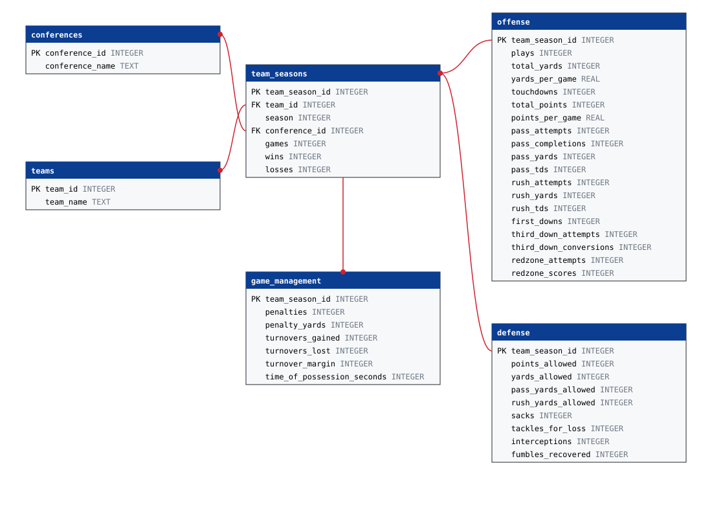

# Shark SQL: Ask College Football Stats in Plain English

A natural-language interface to a SQLite database of college football team statistics (FBS, 2013–2023; source: the Kaggle "College Football Team Stats 2013 to 2023" dataset). You ask a question in English, an LLM (Google Gemini) writes the SQL, the app runs it read-only, and the LLM turns the rows into a plain-English answer. The database holds 134 teams, 11 conferences and 1,364 team-seasons, each with offense, defense and game-management stats.



`teams` and `conferences` are joined through `team_seasons` (one row per team per season; conference is per season because teams move). `offense`, `defense` and `game_management` each have one row per team-season.

## How it works

1. Send the question, the schema (`schema.sql`) and a few notes about the data to the LLM and get one SQLite `SELECT` back.
2. Run it on a read-only connection. Anything that isn't a single `SELECT`/`WITH` is rejected. If the query errors, the error goes back to the model for one retry.
3. Send the question and the result rows to the LLM and get a one- or two-sentence answer.

## Run it

```
pip install -r requirements.txt        # optional: only installs certifi (fixes SSL errors on some Macs)
cp .env.example .env                   # then put your own GEMINI_API_KEY in .env (never commit it)
python3 app.py                         # interactive
python3 app.py "How many wins did BYU have in 2020?"
python3 app.py --strategy single_domain "..."     # zero_shot (default) | single_domain | cross_domain
python3 run_examples.py                # regenerate examples.md (all questions x all strategies)
python3 make_schema_svg.py             # regenerate schema.svg from schema.sql
```

Also supports `--provider openai` (needs `OPENAI_API_KEY`) and `--provider claude` (uses the Claude Code CLI login, no key). Default model is `gemini-3.1-flash-lite`; override with `GEMINI_MODEL`. The Gemini free tier is limited to 5 requests/minute and a daily cap per model, and the app waits and retries when it is rate limited.

`.env` is git-ignored, and a pre-commit hook blocks commits containing key-looking strings.

## A question that worked

**Question:** How many wins did each SEC team have in 2021?

```sql
SELECT T.team_name, TS.wins FROM team_seasons TS JOIN teams T ON TS.team_id = T.team_id JOIN conferences C ON TS.conference_id = C.conference_id WHERE C.conference_name = 'SEC' AND TS.season = 2021;
```

**Answer:** In 2021, Georgia led the SEC with 14 wins, followed by Alabama with 13, Kentucky and Ole Miss with 10, Arkansas with 9, Texas A&M with 8, Mississippi State, South Carolina, and Tennessee with 7, Auburn, Florida, LSU, and Missouri with 6, and Vanderbilt with 2.

All three prompting strategies produced equivalent, correct SQL for this one.

## A question that failed

**Question:** Who was the best team ever?

```sql
SELECT T.team_name, TS.season FROM teams T JOIN team_seasons TS ON T.team_id = TS.team_id ORDER BY (TS.wins * 1.0 / TS.games) DESC, TS.wins DESC LIMIT 1;
```

**Answer:** The best team ever was Clemson in the 2018 season.

The SQL is a reasonable reading of a vague question, but the answer is misleading. Clemson 2018, LSU 2019, Georgia 2022 and Michigan 2023 all went 15-0, so it is a four-way tie that `LIMIT 1` broke arbitrarily, and the answer never says so. Nothing in the data (no championships, strength of schedule or head-to-head results) can settle "best", and the model quietly picked a definition instead of asking. All three strategies gave the identical answer.

A second quirk is a data problem, not a model problem: Ohio St. is recorded as 6-0 in 2020, so the app correctly reports a 100% win rate even though that season isn't a perfect record in real life. The model answers faithfully from the database, including its gaps.

## My own test question

**Question:** How many wins did BYU have in 2020?

```sql
SELECT T1.wins FROM team_seasons AS T1 JOIN teams AS T2 ON T1.team_id = T2.team_id WHERE T2.team_name = 'BYU' AND T1.season = 2020;
```

**Answer:** BYU had 11 wins in 2020. (Matches the database: BYU was 11-1.)

## More examples

[examples.md](examples.md) has 8 questions (more than the 6 required), each run through all three strategies with the SQL and answer. They include a join across three tables, per-season win percentage, a grouped average, a per-game calculation, and a filter on two conditions. Everything was run with `gemini-3.1-flash-lite`.

## Prompting strategies (Nan et al. 2023, arXiv:2305.11853)

- **zero_shot:** schema plus a few notes about the data, and no examples.
- **single_domain:** also two example question/SQL pairs written for this database.
- **cross_domain:** also two example pairs for a different (restaurant) database, so the model sees the pattern but not our tables.

What I saw across the 8 questions:

- **Accuracy was the same.** All three strategies gave the same answer on every question. This schema is small and well labelled, so the model doesn't need examples to get joins right. The paper's gains likely show up on larger or messier schemas.
- **Examples changed style, not correctness.** `single_domain` copied the example's `USING(...)` joins and lowercase aliases, while zero_shot and cross_domain used `ON` joins with `T`/`TS` aliases. Occasionally the examples changed which columns came back. For the 2022 turnover margin question, single_domain also returned the margin itself, which led to the more informative answer "...with a margin of 22." For Ohio St. win percentage, cross_domain returned raw ratios (0.86) instead of percentages.
- **Examples cost tokens.** A question used roughly 800–1,200 tokens in zero_shot and 950–1,350 with examples, an increase of about 15–20%, for no accuracy gain here.
- **The model never pushes back on ambiguity.** It silently picks an interpretation, as in the "best team ever" question, so a short clarifying step would help.
